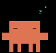

<p align="center">
  
  
  
  
  
  
  
</p>


<h1 align="center">CLAUDE DESKTOP BUDDY · PLUS2 EDITION</h1>

<p align="center">
  <b>A pixel companion for your Claude sessions.</b><br>
  sleep &nbsp;→&nbsp; idle &nbsp;→&nbsp; busy &nbsp;→&nbsp; attention &nbsp;→&nbsp; celebrate &nbsp;→&nbsp; dizzy &nbsp;→&nbsp; heart
</p>

---
> This is a fork of [anthropics/claude-desktop-buddy](https://github.com/anthropics/claude-desktop-buddy) adapted for the M5StickC Plus2.

Claude for macOS and Windows can connect Claude Cowork and Claude Code to maker devices over BLE, so developers and makers can build hardware that displays permission prompts, recent messages, and other interactions. We've been impressed by the creativity of the maker community around Claude - providing a lightweight, opt-in API is our way of making it easier to build fun little hardware devices that integrate with Claude.

> **Building your own device?** You don't need any of the code here. See **[REFERENCE.md](https://github.com/anthropics/claude-desktop-buddy/blob/main/REFERENCE.md)** for the wire protocol: Nordic UART Service UUIDs, JSON schemas, and the folder push transport.

As an example, we built a desk pet on ESP32 that lives off permission approvals and interaction with Claude. It sleeps when nothing's happening, wakes when sessions start, gets visibly impatient when an approval prompt is waiting, and lets you approve or deny right from the device.

---

## What's Here

```
┌─────────────────────────────────────────────────────────────┐
│ 12-hour clock       shows 2:05, not 14:05                   │
│ Clawdie pixel pet   seven 96px GIF states over USB          │
│ Plus2 support       M5Unified build (from PR #3)            │
│ State tester        busy and attention over serial          │
└─────────────────────────────────────────────────────────────┘
```

## Project Layout

```
claude-desktop-buddy/
├── src/main.cpp                 firmware (12-hour clock lives here)
├── characters/clawdie/          manifest.json + 7 GIF states
├── tools/
│   ├── flash_character.py       USB character flasher
│   └── test_states_win.py       busy / attention tester
└── REFERENCE.md                 BLE protocol and folder transfer
```

## How It Works

```
Claude Desktop ──BLE──▶ M5StickC Plus2 ──▶ state
                              ▲
PC (USB) ── flash_character.py┘   GIFs written to storage
PC (USB) ── test_states_win.py┘   fake JSON states for testing
```

- **Firmware:** PlatformIO + M5Unified
- **Bluetooth:** Hardware Buddy pairs and streams state
- **Characters:** 96px-wide GIFs, one per state
- **Testing:** serial JSON, no Claude needed

---

<details>
<summary><b>First-Time Setup</b></summary>

Run each line in **PowerShell**, from the project folder.

**1. Clone and switch branch**
```powershell
git clone https://github.com/YOURNAME/claude-desktop-buddy.git
cd claude-desktop-buddy
git checkout m5unified-pr3
```

**2. Install Python packages**
```powershell
C:\Users\Lenovo\.platformio\penv\Scripts\python.exe -m pip install pillow pyserial
```

**3. Build (checks the toolchain, doesn't flash)**
```powershell
C:\Users\Lenovo\.platformio\penv\Scripts\pio.exe run -e m5stickc-plus
```

**4. Flash the firmware**

> Close Claude Desktop first, then plug the stick in over USB-C.

```powershell
C:\Users\Lenovo\.platformio\penv\Scripts\pio.exe run -e m5stickc-plus -t upload
```

**5. Flash the clawdie pack**
```powershell
C:\Users\Lenovo\.platformio\penv\Scripts\python.exe tools\flash_character.py characters\clawdie
```

> If it starts building `m5stack-sticks3`, press **Ctrl+C**. That's a different board.

**6. Pair with Claude Desktop**

1. **Help → Troubleshooting → Enable Developer Mode**
2. **Developer → Open Hardware Buddy**
3. Click **Connect** and pick the stick

</details>

---

## Controls

| Button | Normal | Approval |
| --- | --- | --- |
| **A** (front) | Next screen | Approve |
| **B** (right) | Next page | Deny |
| **Hold A** | Settings | Settings |
| **Power** (short) | Screen off | — |

---

## The Seven States

| GIF | State | Shown when |
| --- | --- | --- |
|  | `sleep` | Not connected |
|  | `idle` | Connected, nothing running |
|  | `busy` | A session is running |
|  | `attention` | An approval is waiting |
|  | `celebrate` | Level up (every 50K tokens) |
|  | `dizzy` | You shook the stick |
|  | `heart` | You approved in under 5 seconds |

---

<details>
<summary><b>Test Without Claude</b></summary>

1. Close Claude Desktop, or disconnect Hardware Buddy.
2. Find the stick's COM port in **Device Manager**.
3. Set `PORT` at the top of `tools\test_states_win.py`.
4. Run:

```powershell
C:\Users\Lenovo\.platformio\penv\Scripts\python.exe tools\test_states_win.py
```

The stick shows **busy** for 10 seconds, then **attention** for 10 seconds, then the script prints `done`.

</details>

---

<details>
<summary><b>Troubleshooting</b></summary>

| Problem | Fix |
| --- | --- |
| `pio` not recognized | Use the full path shown in setup |
| `&&` is not a valid separator | Run each command on its own line |
| `chunk ack timeout` over Bluetooth | Reconnect, keep the stick close, or flash over USB |
| `Could not resolve host` | `ipconfig /flushdns`, then retry |
| `git push` returns HTTP 408 | `git config http.postBuffer 524288000`, then push again |
| Low disk space | `pio run -t clean`, then `pio system prune` |

</details>

---

## More

- **[REFERENCE.md](REFERENCE.md)**: Bluetooth protocol, JSON schemas, folder transfer format

## Credits

- Firmware base: [anthropics/claude-desktop-buddy](https://github.com/anthropics/claude-desktop-buddy)
- Clawdie sprite: adapted from [bryant24hao/deskpet-firmware](https://github.com/bryant24hao/deskpet-firmware)
- Built with help from Claude (Anthropic).
